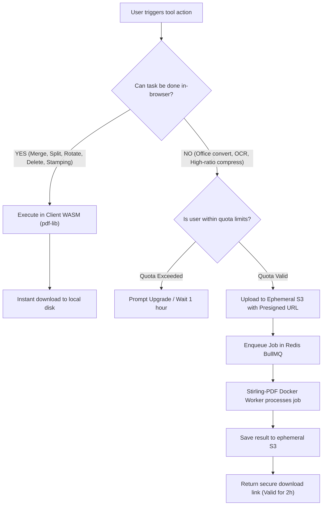

# System Architecture Blueprint

This document details the complete end-to-end infrastructure, service topologies, data pipelines, and security posture of the EyeShots platform.

---

## 1. High-Level Topology

```
┌────────────────────────────────────────────────────────────────────────────────────────┐
│                                    CLIENT LAYER                                        │
│  Next.js 15 (React 19, TypeScript) Web App  OR  Tauri 2.0 (Rust) Desktop App          │
│                                                                                        │
│  ┌────────────────────────────────────────┐  ┌──────────────────────────────────────┐  │
│  │     Client-Side WASM Engine            │  │        Interactive Visual UI         │  │
│  │     • pdf-lib (Merge, Split, Rotate)   │  │        • PDF.js (Page Rendering)     │  │
│  │     • qpdf-wasm (Decrypt / Optimize)   │  │        • Fabric.js (Canvas & Vector) │  │
│  └───────────────────┬────────────────────┘  └───────────────────┬──────────────────┘  │
└──────────────────────┼───────────────────────────────────────────┼─────────────────────┘
                       │                                           │
                       │ (WASM fast path: $0 server egress)        │ (Heavy server route)
                       ▼                                           ▼
┌────────────────────────────────────────────────────────────────────────────────────────┐
│                              API GATEWAY & SAAS BACKEND                                │
│                     Node.js (Hono / Fastify) or Python (FastAPI)                       │
│                                                                                        │
│   • Authentication & Session Management (Clerk / Supabase Auth)                        │
│   • Tier & Quota Rate Limiter (Redis Token Bucket: 3 free tasks/hour)                  │
│   • Stripe Webhook Handler (Subscription state, invoice lifecycle)                     │
│   • Ephemeral Storage Presigned URL Issuer (AWS S3 / Cloudflare R2)                    │
└──────────────────────────────────────────┬─────────────────────────────────────────────┘
                                           │
                                           ▼
┌────────────────────────────────────────────────────────────────────────────────────────┐
│                              ASYNCHRONOUS TASK BROKER                                  │
│                              Redis 7.x + BullMQ Engine                                 │
│                                                                                        │
│   • Priority Queues (Pro users jump ahead of Free tier requests)                       │
│   • Job Retries & Dead Letter Queue for corrupted document handling                    │
│   • Real-time SSE / WebSocket progress events dispatched to client                     │
└──────────────────────────────────────────┬─────────────────────────────────────────────┘
                                           │
                                           ▼
┌────────────────────────────────────────────────────────────────────────────────────────┐
│                         STIRLING-PDF WORKER CLUSTER                                    │
│                 Stateless Docker Swarm / Kubernetes Pods                               │
│                                                                                        │
│   ┌───────────────────────────┐ ┌───────────────────────────┐ ┌─────────────────────┐  │
│   │   Stirling-PDF Core       │ │    LibreOffice Headless   │ │  Tesseract / OCR    │  │
│   │   (Spring Boot / PDFBox)  │ │   (Word/Excel/PPT Conv)   │ │  (OCRmyPDF Engine)  │  │
│   └───────────────────────────┘ └───────────────────────────┘ └─────────────────────┘  │
└──────────────────────────────────────────┬─────────────────────────────────────────────┘
                                           │
                                           ▼
┌────────────────────────────────────────────────────────────────────────────────────────┐
│                         EPHEMERAL STORAGE LIFECYCLE                                    │
│                         S3 / R2 Bucket (2-Hour TTL)                                    │
│                                                                                        │
│   • Strict auto-delete policy: All objects deleted after 120 minutes                   │
│   • Storage cleaner cron daemon guarantees no data persistence                         │
└────────────────────────────────────────────────────────────────────────────────────────┘
```

---

## 2. The Client-First Processing Decision Tree

To deliver maximum speed and minimize infrastructure cost, incoming requests follow a strict routing decision matrix:



---

## 3. Storage Security & 2-Hour Purge Architecture

Data privacy is the core value proposition of EyeShots. 

1. **Direct Uploads via Presigned URLs:**
   - The client never streams file bytes through the API Gateway.
   - The Gateway issues a short-lived AWS S3 / Cloudflare R2 presigned PUT URL.
   - The client uploads directly to isolated S3 prefixes: `uploads/{jobId}/{filename}`.

2. **Automated Lifecycle Policy (Bucket-Level):**
   - The storage bucket is configured with an S3 Lifecycle Rule:
     ```json
     {
       "Rules": [
         {
           "ID": "PurgeTemporaryPDFsAfterTwoHours",
           "Status": "Enabled",
           "Filter": { "Prefix": "" },
           "Expiration": { "Days": 1 }
         }
       ]
     }
     ```
3. **Application-Level Micro-Cleaner:**
   - A Redis TTL key (`job:cleanup:{jobId}`) expires at `now + 7200s`.
   - On key expiration, a background janitor process immediately issues an `s3.deleteObjects()` call, guaranteeing deletion within minutes rather than waiting for cloud provider lifecycle batches.

---

## 4. Desktop Architecture: Tauri 2.0 vs. Electron

Sejda Desktop relies on Electron, bundling an entire Chromium runtime and Java virtual machine, resulting in a ~250MB installer and heavy memory usage.

**EyeShots Desktop Strategy:**
- Built using **Tauri 2.0 (Rust)**.
- Renders using the native operating system webview (WebView2 on Windows, WebKit on macOS).
- Bundles a lightweight compiled micro-engine (or headless worker) locally.
- **Result:**
  - Installer size: **< 35 MB** (vs. Sejda's 250 MB).
  - RAM footprint: **< 45 MB** (vs. Sejda's 300+ MB).
  - 100% offline functionality with zero external network connectivity.
