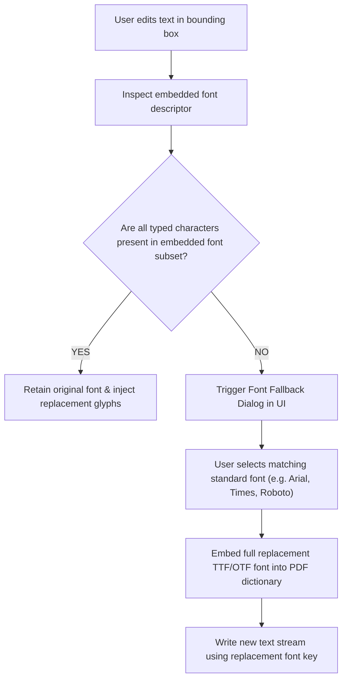

# In-Place PDF Text Editor: Technical Implementation Strategy

Directly editing text inside an existing PDF document is widely recognized as one of the hardest challenges in software engineering. This document details the exact technical strategy to replicate and surpass Sejda's signature PDF editing experience.

---

## 1. Why PDF Text Editing is Difficult

PDF is fundamentally a **presentation format**, not an authoring format like Word or HTML:
1. **No Reflow or Paragraph Concepts:** A PDF does not understand "sentences" or "paragraphs". It stores independent drawing commands (operators) such as:
   ```postscript
   BT
     /F1 12 Tf
     72 712 Td
     (Hello World) Tj
   ET
   ```
2. **Font Subsetting:** To minimize file size, PDF creators embed only the subset of characters used in the document. If a document embeds the characters `H, e, l, o, W, r, d`, the font file inside the PDF does not contain glyphs for `a, b, c, x, y, z`. Typing new letters results in invisible or corrupt glyphs.
3. **Hardcoded Coordinates:** Each word has fixed coordinates. Inserting a word does not naturally "push" the next word down without manual calculation.

---

## 2. The Two-Layer Architecture: Canvas UI + Backend Stream Rewriter

```
┌────────────────────────────────────────────────────────────────────────────────────────┐
│                               FRONTEND BROWSER CLIENT                                  │
│                                                                                        │
│  ┌──────────────────────────────────────────────────────────────────────────────────┐  │
│  │ Layer 3: Interactive Editing Surface (Fabric.js / HTML5 ContentEditable)         │  │
│  │          • Draggable bounding boxes around identified text                       │  │
│  │          • In-place text input field with real-time typography styling           │  │
│  │          • Shapes, freehand signatures, image stamps, whiteout redactions        │  │
│  ├──────────────────────────────────────────────────────────────────────────────────┤  │
│  │ Layer 2: Text Extraction & Coordinate Map (PDF.js TextContent Layer)             │  │
│  │          • Extracts glyph coordinates (x, y, width, height, fontName, fontSize) │  │
│  │          • Groups adjacent glyph spans into editable logical line blocks         │  │
│  ├──────────────────────────────────────────────────────────────────────────────────┤  │
│  │ Layer 1: Base Page Raster / Canvas (PDF.js Canvas Renderer)                      │  │
│  │          • High-fidelity vector rendering of background graphics and unchanged   │  │
│  │            page content                                                          │  │
│  └──────────────────────────────────────────────────────────────────────────────────┘  │
└──────────────────────────────────────────┬─────────────────────────────────────────────┘
                                           │
                                           │ Dispatches JSON Delta:
                                           │ { page: 1, originalBox: [72, 712, 100, 14],
                                           │   oldText: "Hello World", newText: "Hello Earth",
                                           │   font: "Helvetica", fontSize: 12 }
                                           ▼
┌────────────────────────────────────────────────────────────────────────────────────────┐
│                               BACKEND STREAM REWRITER                                  │
│                             (PyMuPDF / Apache PDFBox)                                  │
│                                                                                        │
│   1. Redacts the original text bounding box (clearing the old operator from stream)   │
│   2. Embeds standard replacement font metrics (Helvetica / Roboto)                     │
│   3. Injects the new text operator at the exact baseline coordinates                   │
│   4. Flattens user-drawn shapes, signatures, and form fields into the PDF stream       │
└────────────────────────────────────────────────────────────────────────────────────────┘
```

---

## 3. Resolving the Font Subsetting Problem (Sejda Parity)

When a user clicks on an existing word and types:



---

## 4. Phased Implementation Roadmap

### Phase 1: Annotation & Stamping Editor (Weeks 1–3)
- Deliver 80% of everyday user needs without low-level stream hacking.
- Users can:
  - Add new text blocks anywhere on the page.
  - Draw freehand signatures or upload PNG signatures.
  - Whiteout sensitive information (redaction rectangle).
  - Add checkmarks, circles, and date stamps.
  - Flatten all annotations into the final PDF using `pdf-lib`.

### Phase 2: Form Field Builder & Fill/Sign (Weeks 4–5)
- Allow creating and filling interactive AcroForms (`/Btn`, `/Tx`, `/Ch`).
- Export and import form data.

### Phase 3: True In-Place Text Replacement (Weeks 6–8)
- Implement line-level glyph parsing via PDF.js `getTextContent()`.
- Calculate character kerning and baseline coordinates.
- Dispatch stream rewrite commands to backend PyMuPDF / PDFBox workers.
