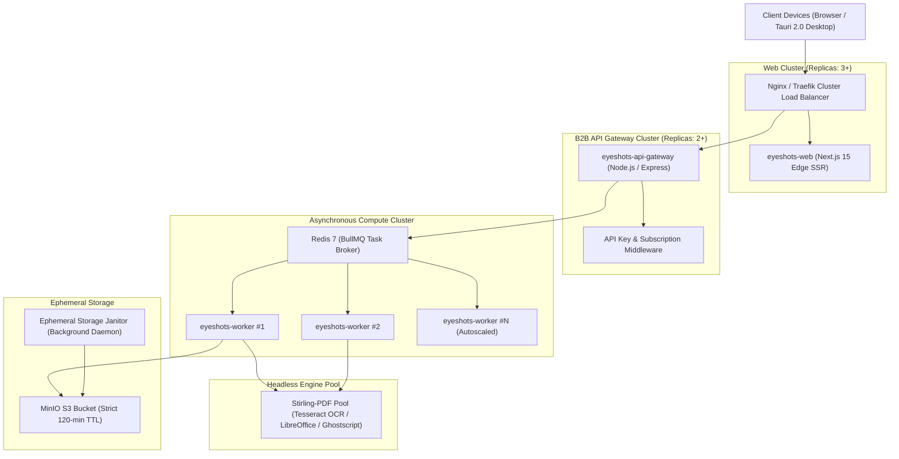

# EyeShots: Enterprise Cluster Architecture, B2B Accounting & Legal Services, DMS & Audio Annotations

This document sets the operational architecture, API specifications, and subscription models for enterprise cluster deployment, automated accounting/legal integrations, central DMS, multi-language translation, and voice explanation memos.

---

## 1. Decoupled Cluster Architecture

The application is decoupled into independent microservice layers capable of horizontal autoscaling across Kubernetes, Docker Swarm, or AWS ECS.

### Cluster Manifests:
- **Docker Compose Cluster:** [docker-compose.cluster.yml](file:///d:/EyeShots/docker-compose.cluster.yml)
- **Kubernetes Manifests:** [deploy/k8s/eyeshots-cluster.yaml](file:///d:/EyeShots/deploy/k8s/eyeshots-cluster.yaml)

---

## 2. B2B APIs for Accounting Software & Legal Filings

All enterprise routes require an API key (`X-API-KEY: eyeshots_live_...`) issued via the Central Admin console.

### 2.1 Accounting Softwares (ERP, QuickBooks, Xero)
| Endpoint | Method | Input | Output / Format | Description |
| :--- | :--- | :--- | :--- | :--- |
| `/api/v1/accounting/extract-invoice` | `POST` | `multipart/form-data` | `JSON` | Extracts invoice number, dates, vendor metadata, line items, taxes, and totals. |
| `/api/v1/accounting/table-to-json` | `POST` | `multipart/form-data` | `JSON` / `CSV` | Converts bank statements, balance sheets, and transaction grids into arrays. |
| `/api/v1/accounting/pdf-a` | `POST` | `multipart/form-data` | `PDF/A-2b` | Formats invoices and tax records into ISO-compliant long-term archives. |

### 2.2 Legal Document Filings & Verifications
| Endpoint | Method | Input | Output / Format | Description |
| :--- | :--- | :--- | :--- | :--- |
| `/api/v1/legal/verify-signatures` | `POST` | `multipart/form-data` | `JSON` | Validates digital certificates (PAdES / X.509), signer email, timestamp, and tamper status. |
| `/api/v1/legal/bates-numbering` | `POST` | `multipart/form-data` | `PDF` | Applies sequential discovery Bates numbering (`EXHIBIT-000001`, `CONFIDENTIAL-000100`). |

---

## 3. Central Admin & Subscriber DMS Management

### 3.1 Subscriber DMS Workspace (`/dms`)
- **Location:** [apps/web/app/dms/page.tsx](file:///d:/EyeShots/apps/web/app/dms/page.tsx)
- **Multi-Project Management:** Create and organize folders across Legal Discovery, Tax Filings, and Corporate Contracts.
- **Document Status Tags:** `Draft`, `Signed`, `Verified`, `Archived`.
- **Ephemeral TTL Counters:** Real-time countdown tracking the 2-hour auto-scrub lifecycle.

### 3.2 Central Admin Console (`/admin`)
- **Location:** [apps/web/app/admin/page.tsx](file:///d:/EyeShots/apps/web/app/admin/page.tsx)
- **Subscription Management:**
  - `Free Sandbox`: $0 (25 MB max upload, 3 projects, client-side only).
  - `Pro Individual`: $12/month (200 MB max upload, 50 projects, 1,000 API calls/hr).
  - `Enterprise Team`: $49/month (1 GB max upload, 1,000 projects, unlimited API gateway access).
- **Cluster Node Health:** Live monitoring of CPU %, memory usage, and node counts.

---

## 4. Free & Accurate Translation & Summarization

### 4.1 In-Place Text Selection Translation
- **Engine:** [apps/web/lib/ai/translation-service.ts](file:///d:/EyeShots/apps/web/lib/ai/translation-service.ts)
- **Interactive Component:** [apps/web/components/editor/TextSelectionTranslator.tsx](file:///d:/EyeShots/apps/web/components/editor/TextSelectionTranslator.tsx)
- **Zero Server Cost:** Leverages public MyMemory/LibreTranslate open standards and browser NLP.
- **Workflow:** Select any text in a document $\rightarrow$ floating tooltip displays instant translation across 20+ languages (Spanish, German, French, Arabic, Chinese, Japanese, etc.) with 1-click text replacement.

### 4.2 Multi-Language Document Summarizer
- **TextRank Extractive Engine:** Analyzes term frequency, inverse document frequency, and paragraph weights to output:
  - Executive Takeaway (3–4 concise sentences).
  - Key Legal & Financial Action Items (obligations, payments, deadlines).

---

## 5. Voice Explanation Notes & Audio Memos

- **Component:** [apps/web/components/editor/VoiceAnnotationRecorder.tsx](file:///d:/EyeShots/apps/web/components/editor/VoiceAnnotationRecorder.tsx)
- **Web Audio MediaRecorder:** Captures high-clarity microphone memos directly in the browser with zero third-party tracking.
- **Document Pinning:** Audio memos are labeled (e.g. *"Indemnity Clause Review"*) and pinned to specific page numbers.
- **Playback & Export:** Integrated player with waveform indicators, duration timers, and playback controls.
